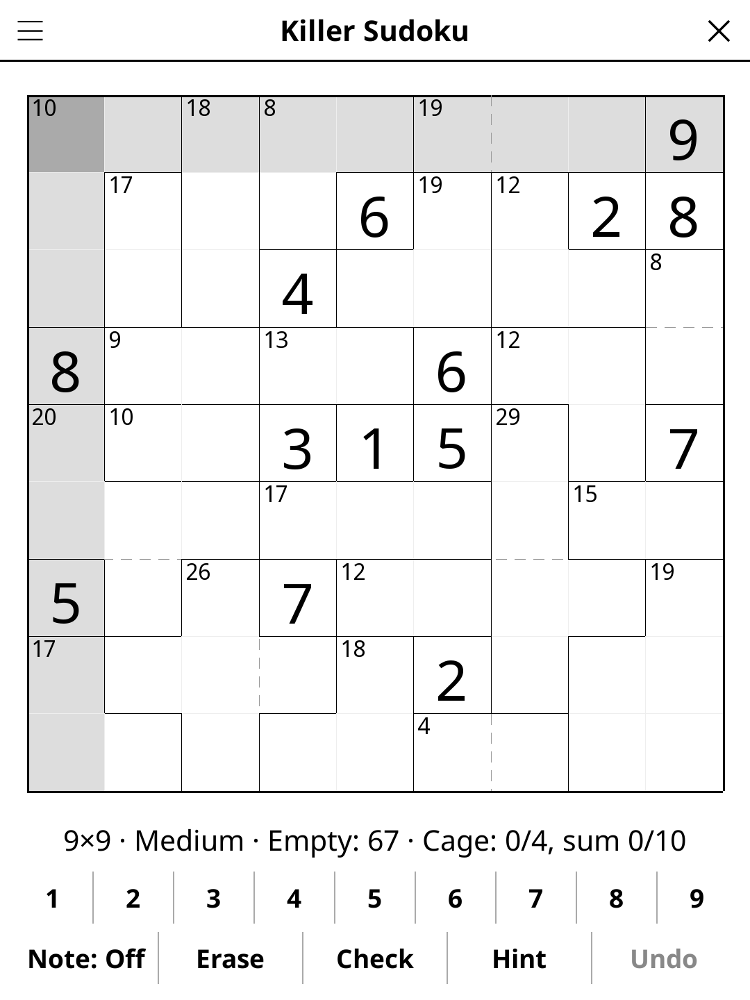

# sudokukiller.koplugin

A Killer Sudoku plugin for [KOReader](https://github.com/koreader/koreader).

## Screenshot

## Rules

Standard Sudoku rules (fill 1–9; no repeats in rows, columns, or 3×3 boxes) plus **cage constraints**: cells are grouped into cages, each labelled with a target sum. The digits in each cage must add up to that sum with no repeats within the cage.

## Features

- **Four difficulty levels** — Easy, Medium, Hard and Expert
- **Hint** — two taps: the first says which cell is about to give, the second fills it. Works on Easy and Medium, which are now solvable by deduction alone; Hard and Expert stay genre-pure (no given digits) and the cages alone do not decide them, so there it says so rather than guessing
- **Cage highlighting** — tapping a caged cell highlights the whole cage
- **Note mode** — pencil in candidate digits
- **Check** — highlights incorrect cells
- **Reveal solution** — shows the full solution
- **Undo** — step back through your moves
- **Auto-save** — game state saved and restored on next launch

## Installation

1. Download `sudokukiller.koplugin.zip` from the [latest release](../../releases/latest).
2. Extract into the `plugins/` folder of your KOReader data directory.
3. Restart KOReader.
4. Open the menu → **Tools** → **Killer Sudoku**.

## Controls

| Action | How |
|--------|-----|
| Select a cell | Tap it |
| Enter a digit | Tap the digit button |
| Erase a cell | Tap **Erase** |
| Toggle note mode | Tap **Note: Off / On** |
| Undo last move | Tap **Undo** |
| Check progress | Tap **Check** |
| New game | Tap **New game** |
| Change difficulty | Tap **Difficulty** |
| Show rules | Tap **Rules** |

## Known limitations

Easy and Medium puzzles are always solvable by deduction alone (no
guessing): the generator adds given digits until they are. It also caps how
much cage reasoning they ask for — working out which digits fit a cage, or
the 45 rule: at most 3 such steps on Easy, 8 on Medium, the rest is plain
singles. Hard and Expert carry no given digits, as in a classic Killer
Sudoku, and the cages alone do not always decide them.

## License

GPL-3.0 — see [LICENSE](LICENSE).
